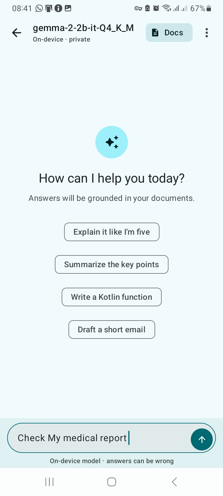
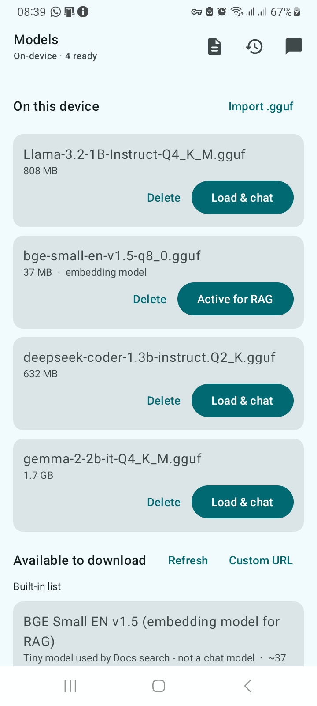
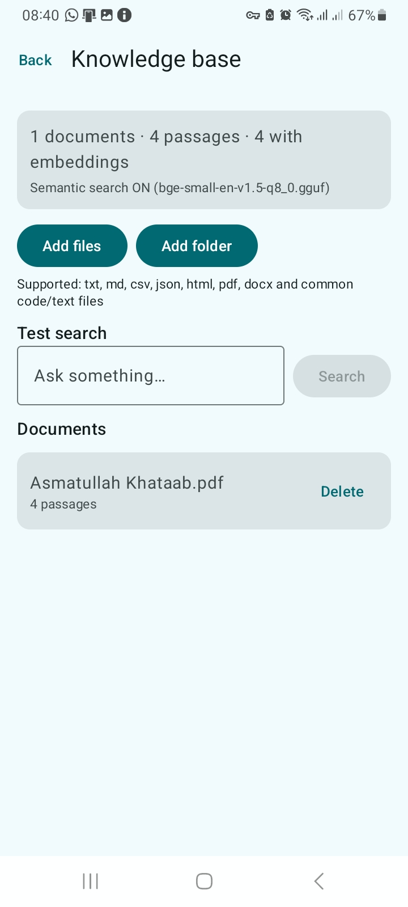

# Local AI

**A private, offline ChatGPT for your phone.** Runs GGUF language models entirely on-device with
[llama.cpp](https://github.com/ggml-org/llama.cpp) through a small JNI bridge — no API keys, no
account, no network after the model is downloaded.


## Screenshots

| Chat | Models | Knowledge base |
| :--: | :----: | :------------: |
|  |  |  |
| Rendered answers, suggestion chips, chat-style composer | Download, import and load GGUF models | Index your own documents for retrieval |

## Download the APK

**[`apks/app-debug.apk`](apks/app-debug.apk)** — 76 MB, `versionName 1.0`, debug-signed, **arm64-v8a only**,
Android 9 (API 28) or newer.

```bash
adb install -r apks/app-debug.apk
```

Or copy the file to the phone and open it (allow "install unknown apps" for your file manager).
Models are **not** bundled — download one in the app, or import a `.gguf` you already have.

> The APK is large because it ships the optimized llama.cpp native library. Prefer
> [GitHub Releases](../../releases) for binaries so the repository stays small.

## Features

**Chat**
- Token-by-token streaming with a caret and a working **Stop** that halts generation at the native
  layer, even while a long prompt is still being processed.
- Model output rendered as real Markdown: headings, lists (nested), quotes, rules, tables,
  fenced code blocks with a language header, horizontal scrolling and a per-block **Copy** button.
- Syntax-highlighted code, inline `code`, **bold**, *italic*, ~~strikethrough~~, and clickable links
  (markdown links and bare URLs).
- Per-answer **Copy** / **Regenerate**, plus retrieval **sources** shown as chips.
- Streaming-safe formatting: an unclosed fence still renders as code, unmatched `**` stays literal,
  and chat-template markers (<code>&lt;|im_end|&gt;</code>, <code>&lt;end_of_turn&gt;</code>,
  <code>&lt;/s&gt;</code>, DeepSeek's <code>｜end▁of▁sentence｜</code>) are stripped instead of being
  shown to you.
- Auto-scroll only while you are at the bottom, with a "jump to latest" button; scroll up mid-answer
  and it stops yanking you back.
- Persistent history (Room). Multi-line composer, Enter to send, Stop while generating.

**Models**
- Curated download list (cached for offline use), resumable background downloads via WorkManager,
  custom URL entry, and **Import .gguf** from phone storage.
- Load/delete models, live model name in the chat bar, embedding model selection for Docs.

**Docs (RAG) — chat with your own files**
- Add files (txt, md, csv, json, html, pdf, docx, code) or **index a whole folder** recursively;
  *Re-sync* picks up new, changed and deleted files.
- Hybrid retrieval (vector + BM25); answers cite their sources. Without an embedding model it falls
  back to keyword search. **Test search** shows exactly what gets retrieved.
- Everything is read through the Android file picker — no storage permission, no uploads.

## Build it

**Requirements:** Android Studio (Ladybug or newer), JDK 17, NDK, CMake 3.22.1, internet for the
first build.

1. **Open** this folder in Android Studio and let Gradle sync. The first sync downloads llama.cpp
   (`b11946`), so **git and network access are required**.
2. If prompted, install **NDK** and **CMake 3.22.1** (SDK Manager → SDK Tools).
3. Plug in a real **arm64** Android phone (Android 9+) with USB debugging on. Emulators work only if
   you add `x86_64` to `abiFilters`, and they are far too slow to be useful.
4. Run, then **Models → Download a model** (start with Qwen 2.5 1.5B) → **Load & chat**.

```bash
./gradlew :app:assembleDebug        # APK -> app/build/outputs/apk/debug/
./gradlew :app:testDebugUnitTest    # 30 unit tests
```

## Project layout

| Path | What lives there |
| ---- | ---------------- |
| `app/src/main/cpp/` | CMake + `llama_jni.cpp` (generation loop, chunked prefill, embeddings) |
| `llm/` | `LlamaBridge` (JNI surface), `LlamaEngine` (coroutines/Flow), `ControlMarkers` (template-marker scrubber) |
| `ui/` | Compose screens + ViewModels: chat, models, history, knowledge base |
| `ui/markdown/` | Dependency-free Markdown parser and Compose renderer |
| `rag/` | Text extraction (PDFBox), chunking, embeddings, hybrid retrieval |
| `data/` | Model catalog, downloads, storage import, Room database |
| `images/` | Screenshots used above |
| `apks/` | Ready-to-install debug APK |

## How it works

- `LlamaEngine` owns the loaded model and runs every blocking native call on one dedicated thread.
  Generation is a `Flow<String>`; cancelling the collector stops generation.
- The prompt is built with the model's own chat template (`llama_chat_apply_template`, falling back
  to ChatML) and prefilled in 256-token chunks so **Stop** is honoured within a fraction of a second.
- The native loader is built as a Release binary even inside debug APKs, so sampling stays fast.
- Chat state lives in a ViewModel; each turn owns its own answer buffer, so a stopped turn can never
  overwrite the next one.

## Configure

- **Your own model list:** host a JSON like [`app/src/main/assets/models.json`](app/src/main/assets/models.json)
  and set `REMOTE_CATALOG_URL` in [`LocalAiApp.kt`](app/src/main/java/com/example/localai/LocalAiApp.kt).
- **Context size / threads:** `LlamaEngine.load()`.
- **Sampling** (top-k, top-p, temperature): sampler chain in `llama_jni.cpp`.
- **Emulator builds:** add `"x86_64"` to `abiFilters` in `app/build.gradle.kts`.

## Known limitations

- **arm64 only.** No x86/x86_64 build is shipped; you must add the ABI yourself.
- Speed depends entirely on the phone. A 1–2B model at Q4 is comfortable; 7B+ is slow.
- Scanned/image-only PDFs have no extractable text (no OCR).
- The shipped APK is a **debug** build — installable and fast, but not signed for the Play Store.

## Credits

Built on [llama.cpp](https://github.com/ggml-org/llama.cpp) (MIT), [PDFBox-Android](https://github.com/TomRoush/PdfBox-Android),
OkHttp, Room and Jetpack Compose. Models you download keep their own licenses — check them before
redistributing.

No project license file is included yet; add one before accepting contributions.
